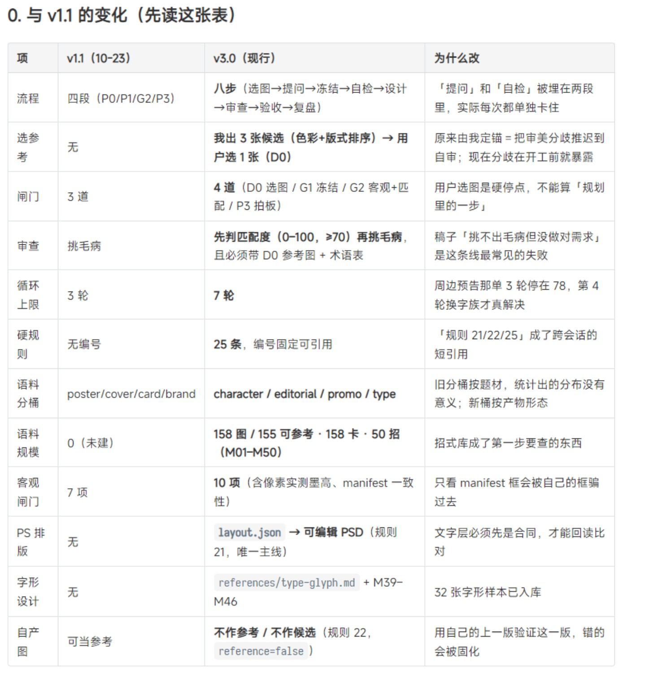

# 用户截图：v1.1 → v3.0 可见变化

本次实际查看原图后转录。下表证明截图写了什么；未核实其作者、对应代码、资产数量或执行记录。原图标题为“0. 与 v1.1 的变化（先读这张表）”。

| 项 | v1.1（10-23） | v3.0（现行） |
|---|---|---|
| 流程 | 四段（P0/P1/G2/P3） | 八步：选图→提问→冻结→自检→设计→审查→验收→复盘 |
| 选参考 | 无 | 我出 3 张候选（色彩+版式排序）→用户选 1 张（D0） |
| 闸门 | 3 道 | 4 道：D0 选图 / G1 冻结 / G2 客观+匹配 / P3 拍板 |
| 审查 | 挑毛病 | 先判匹配度（0–100，≥70）再挑毛病；必须带 D0 参考图与术语表 |
| 循环上限 | 3 轮 | 7 轮 |
| 硬规则 | 无编号 | 25 条，编号固定可引用 |
| 语料分桶 | poster / cover / card / brand | character / editorial / promo / type |
| 语料规模 | 0（未建） | 158 图 / 155 可参考 · 158 卡 · 50 招（M01–M50） |
| 客观闸门 | 7 项 | 10 项，含像素实测墨高、manifest 一致性 |
| PS 排版 | 无 | layout.json → 可编辑 PSD（规则 21，唯一主线） |
| 字形设计 | 无 | references/type-glyph.md + M39–M46；备注称 32 张字形样本已入库 |
| 自产图 | 可当参考 | 不作参考 / 不作候选（规则 22，reference=false） |

## 截图列出的调整理由

- 提问和自检原先埋在两段里，实际会单独卡住，所以显式拆开。
- 原先由系统定锚，审美分歧被推迟到自审；候选与用户选图让分歧在开工前显露，D0 是硬停点。
- 先核方向匹配，是为避免“挑不出毛病但没做对需求”。
- 七轮上限的理由是一个案例前三轮停在 78、第四轮换字族后才解决；这是截图叙述，本次未见逐轮产物。
- 固定编号服务跨会话短引用；分桶改按产物形态；招式库成为开工前检索对象。
- 客观检查增加真实墨迹测量；文字先形成合同，才能回读比对。
- 不用自己的上一版验证下一版，避免错误固化。

## 不能从截图认定的事

不能认定八步已端到端跑通、七轮一定优于三轮、≥70 是有效质量阈值、158 个文件均存在、50 招均有效、PS 已在当前环境接通或跨会话记忆已恢复。截图没有展示真实作品对照。

截图的 50 招与报告的 46 招、10 项闸门与报告的 9 项闸门分别登记，等待资产清单、版本记录与实际检查定义。这里不把 v3.0 自动称为 DSH 已部署版本。
